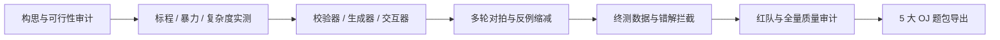

<div align="center">


<h1>AutoCode</h1>

<p><strong>面向 ACM / OI 竞赛编程的 AI 自动出题与独立验题引擎</strong><br />
<sub>AI 负责生成候选内容，AutoCode 负责让每道题都经得起实测。</sub></p>

[](https://github.com/SZTU-ACM/AutoCode/releases)
[](https://github.com/SZTU-ACM/AutoCode/actions/workflows/ci.yml)
[](https://www.python.org/)
[](LICENSE)
[](https://modelcontextprotocol.io/)

[核心能力](#核心能力) · [快速开始](#快速开始) · [支持生态](#支持生态) · [示例题包](#示例题包) · [参考文档](docs/REFERENCE.md)

</div>

---

AutoCode 将竞赛命题中最容易出错的环节——样例算错、范围漂移、复杂度误判、UB 漏洞、水数据、错解漏杀与导出错位——全部收口为可执行的工程门禁，同时提供两套互补入口：

| 使用模式 | 适用场景 | 核心工作方式 |
| :--- | :--- | :--- |
| **AI 自动出题** | 用 Claude Code / Codex / DeepSeek Harness / Antigravity 从零命题 | 通过 MCP 服务端门禁与工作流 Agent 推进命题，缺少对拍或验题门禁时自动拦阻跳步 |
| **零 AI 独立验题** | 赛前复核人工或外部题包、GitHub Actions PR 自动审题 | 不依赖任何大模型，对现成题包只读审计并输出可量化的通过 / 阻断报告 |

---

## 核心能力

- **四大题型全覆盖**：原生支持标准题、Special Judge、交互题（自动检查 flush、死锁与超限）以及三类通信题（`run_twice` / `grader_linked` / `multi_process`）。
- **实测驱动，拒绝“看起来对”**：核对题面约束与校验器上下界、通过多规模实测与硬件计数拟合真实复杂度、自动运行 ASan/UBSan/MSan 内存探针，并对标程与暴力解执行自动对拍与最小反例缩减。
- **数据强度与红队审题**：生成覆盖小数据、随机、极限与防卡常构造的数据集，结合分支覆盖率、变异测试与错解拦截矩阵定位薄弱点，通过专职红队审计拦截“水过”的题目。
- **沙箱隔离与可视化视图**：支持多语言分倍率评测与可插拔沙箱隔离，并在 MCP 客户端内置复杂度拟合图、审计仪表盘与交互/通信回放视图。
- **一次命题，对接 5 大 OJ**：支持导出 Polygon、Hydro、QOJ、ICPC/Kattis 与 IOI CMS 并自动回读校验，支持 Polygon REST 同步与 Typst PDF 题面排版。

## 工作流程



---

## 快速开始

### 前置环境

- **Python 3.10+** · **[uv](https://docs.astral.sh/uv/)** · **支持 C++20 的 `g++`**（推荐 GCC 10+；`testlib.h` 与 `jngen.h` 已内置，无需额外下载）

### 方式一：AI 自动出题（安装插件）

所有受支持的 AI 客户端均通过官方插件分发仓库 [`SummerOneTwo/autocode-marketplace`](https://github.com/SummerOneTwo/autocode-marketplace) 获取同步版本：

<details open>
<summary><strong>按客户端安装命令</strong>（Claude Code / Codex / DeepSeek Harness / Antigravity）</summary>

**Claude Code**

```bash
claude plugin marketplace add https://github.com/SummerOneTwo/autocode-marketplace.git
claude plugin install autocode@autocode-marketplace
```

**Codex**

```bash
codex plugin marketplace add https://github.com/SummerOneTwo/autocode-marketplace.git
codex plugin add autocode@autocode-marketplace
```

**DeepSeek Harness (`dsh`)**

```bash
git clone https://github.com/SummerOneTwo/autocode-marketplace.git
dsh plugin add ./autocode-marketplace/plugins/autocode-dsh/.dsh-plugin
```

**Antigravity (`agy`)**

```bash
git clone https://github.com/SummerOneTwo/autocode-marketplace.git
mkdir -p ~/.gemini/config/plugins && rm -rf ~/.gemini/config/plugins/autocode
cp -R ./autocode-marketplace/plugins/autocode-agy ~/.gemini/config/plugins/autocode
```

</details>

<details>
<summary><strong>让 AI 帮你一键安装或更新</strong></summary>

把下面这段直接发给正在使用的 AI 客户端，它会按所处宿主从 `autocode-marketplace` 完成安装或更新：

```text
请帮我从 https://github.com/SummerOneTwo/autocode-marketplace.git 为当前 AI 客户端安装或更新 AutoCode 插件，检查 Python 3.10+、uv 与支持 C++20 的 g++ 是否就绪，并告诉我如何开始第一道竞赛编程题。
```

</details>

安装完成后，直接向 AI 描述你的出题目标即可按门禁推进：

```text
用 AutoCode 创建一道竞赛编程题：给定数组，支持若干次区间查询。请先审计题意可行性，再按完整工作流生成题包。
```

### 方式二：独立命令行验题（零 AI 依赖）

无需配置任何 AI 客户端，可直接安装命令行工具对现有题包做只读验题：

```bash
# 从 GitHub Release Tag 安装（或从 Releases 下载 wheel 离线安装）
uv tool install git+https://github.com/SZTU-ACM/AutoCode.git@v4.0.0
```

对任意外部题包运行只读质量审计（自动识别 Polygon / Hydro / QOJ / 国内常规布局，不修改原目录）：

```bash
autocode-audit /path/to/problem_dir \
  --standalone --layout auto --sandbox auto --mutation-check --strict \
  --format markdown --report audit_report.json
```

若要在命题仓库的 Pull Request 中自动执行审题门禁，可复用工作流模板 [examples/ci/autocode-problem-audit.yml](examples/ci/autocode-problem-audit.yml)（`0=go` 放行，`2=no_go` 拦阻）。

> [!WARNING]
> **PR CI 安全边界**：`autocode-audit` 会编译并执行题包中的 C++ 源码。处理不可信 PR 时，请仅在一次性的 GitHub-hosted runner（如 `ubuntu-latest`）上运行，`permissions` 设为只读，切勿使用带有持久状态或特权的 `self-hosted` runner、切勿向审题 Job 注入 Secrets，且切勿改用 `pull_request_target`。

---

## 支持生态

| 维度 | 原生支持 |
| :--- | :--- |
| **AI 客户端** | Claude Code · Codex · DeepSeek Harness (`dsh`) · Antigravity (`agy`) |
| **题型** | 标准题（Exact）· Special Judge · 交互题 · 通信题（`run_twice` / `grader_linked` / `multi_process`） |
| **评测语言** | C++ · Python · PyPy · Rust · Java |
| **OJ 导出格式** | Polygon · Hydro · QOJ · ICPC / Kattis · IOI CMS |
| **沙箱后端** | `auto` · `bwrap` · `nsjail` · `isolate` · `apple_container` |

## 示例题包

- [examples/exact-sample](examples/exact-sample)：标准精确输出题（含 `int32` 溢出错解对照）
- [examples/checker-sample](examples/checker-sample)：Special Judge 构造题（双合法解 + 贪心错解对照）
- [examples/interactive-sample](examples/interactive-sample)：交互题（二分标程 + 超查询次数错解 + `interactor.cpp`）
- [examples/communication-sample](examples/communication-sample)：两阶段噪声信道通信题（含子任务依赖与 `communicator.cpp`）
- [examples/ci/autocode-problem-audit.yml](examples/ci/autocode-problem-audit.yml)：命题仓库 GitHub Actions PR 自动审题模板

## 深入文档

| 文档 | 内容 |
| :--- | :--- |
| [docs/REFERENCE.md](docs/REFERENCE.md) | 工作流门禁详情、交互/通信题开发契约、目录与 `manifest.json` 规范、22 个 MCP 工具列表、附加 CLI 与本地开发 |
| [TROUBLESHOOTING.md](TROUBLESHOOTING.md) | 编译器配置、沙箱依赖与常见问题排查 |
| [CHANGELOG.md](CHANGELOG.md) | 版本发布历史与更新说明 |
| [CLAUDE.md](CLAUDE.md) | 仓库架构说明与开发者规范 |
| [CONTRIBUTING.md](CONTRIBUTING.md) | 参与贡献指南 |

---

## 致谢与协议

- 基于论文 [*AutoCode: LLMs as Problem Setters for Competitive Programming*](https://arxiv.org/abs/2510.12803) 演进，测试库基于 [testlib.h](https://github.com/MikeMirzayanov/testlib) 与 [jngen.h](https://github.com/ifsmirnov/jngen)。
- 本项目基于 [MIT License](LICENSE) 开源。
