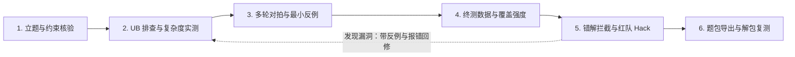

<div align="center">
  
  <h1>AutoCode</h1>
  <p><strong>面向 ACM / OI 竞赛编程的自动出题与自动验题工作流</strong></p>
  <p>
    <a href="https://github.com/SZTU-ACM/AutoCode/releases"></a>
    <a href="https://github.com/SZTU-ACM/AutoCode/actions/workflows/ci.yml"></a>
    
    
    <a href="LICENSE"></a>
    <a href="https://modelcontextprotocol.io/"></a>
  </p>
  <p>
    <a href="#一道题是如何被打磨出来的">完整流程</a> · <a href="#支持的能力">支持能力</a> · <a href="#快速开始">快速开始</a> · <a href="#示例与文档">示例与文档</a> · <a href="docs/REFERENCE.md">参考文档</a>
  </p>
</div>

---

出过题、验过题的 ACMer 都知道，一场比赛最怕的从来不是想不出好 Idea，而是那些开赛后才爆出来的锅：**样例手算错了、题面范围和 `val.cpp` 写反、暴力常数小水过时限、假贪心没人卡掉、交互题漏 flush 直接死锁**。绝大多数赛场事故，根源都是验题链路里少跑了某一步，或者凭直觉跳过了实测。

**AutoCode** 接入你常用的 AI 编程客户端，把整套 ICPC / Codeforces 级别的出题与验题规范做成了**必须实测通过才能推进的闭环**：`val.cpp` 没拦住非法输入就不算过关，标程 `std` 与暴力 `brute` 没跑通对拍就不造终测，预设的假做法和暴力没全被卡掉就不打包导出——让每一道题从 Idea 到可评测的 OJ 题包，每一步都有实测兜底。

---

## 一道题是如何被打磨出来的



1. **立题与约束核验**：定好题面、时空限制与数据范围，写出标程 `std`、独立暴力 `brute`、`val.cpp`（以及 SPJ `checker.cpp` 或交互器 `interactor.cpp`），自动核对题面约束与校验器是否一致，并用标程跑通所有样例。
2. **UB 排查与复杂度实测**：开启 ASan / UBSan / MSan 扫清越界、溢出与未定义行为；在多组递增规模 $n$ 下实测耗时与硬件指令开销，拟合真实时间复杂度，既防标程常数过大，也防次优暴力靠小常数混过时限。
3. **多轮对拍与最小反例**：用 `gen.cpp` 在小数据上高强度对拍 `std` 与 `brute`，一旦撞出差异自动缩减出**最小 Hack 反例**，一眼就能定位错在哪。**对拍未通过，不允许进入终测生成。**
4. **终测数据与覆盖强度**：按极限、卡常、边界、随机配比构造终测，所有输入强制过 `val.cpp`；同时统计标程的分支覆盖情况，补齐平时随机数据很难走到的角落逻辑。
5. **错解拦截与红队 Hack**：把常见假贪心、漏特判、爆 `int`、超时暴力写成错解逐一轰终测，确认每个错解都精准命中预期结果（`AC / WA / TLE / MLE / RE / PE`）；再微调标程做变异检测、配合独立视角的红队 Hack，查出数据里任何可能漏杀的薄弱点。**错解未杀干净，不允许打包。**
6. **题包导出与解包复测**：一键导出 Polygon、Hydro、QOJ、ICPC-Kattis 或 IOI CMS 题包，导出后自动解包重测一遍确认格式与数据无误，也可直接同步到 Polygon 或用 Typst 排版 PDF 题面。

### 实际用起来是什么体验

**从零出一道新题**
> 「帮我出一道树上贪心结合倍增的 ICPC 区域赛中档题，时限 2s / 512MB。按 AutoCode 完整流程走完：写好题面、`std`、$O(n^2)$ `brute` 和 `val.cpp`，过完 UBSan 和多轮对拍后再用 `gen.cpp` 造终测，务必构造卡掉假贪心以及链、菊花图退化的卡常数据，最后导出 Polygon 题包并生成 Typst PDF。」

**给已有题包做赛前体检并补强数据**
> 「帮我对 `./contest/problem-G` 做全套赛前体检：查一下题面范围和 `val.cpp` 有没有写反，用 ASan / UBSan 扫一遍 `std` 和 `checker.cpp`，测一遍现有数据的覆盖情况和错解拦截率；如果发现能水过的假做法或小常数暴力，直接找最小反例补进测试点。」

---

## 支持的能力

| 维度 | 覆盖范围 |
| :--- | :--- |
| **四大题型** | 标准题、Special Judge（`checker.cpp`）、交互题（`interactor.cpp`）、通信题（两阶段 `run_twice` / Grader 联编 `grader_linked` / 多进程 `multi_process`）；内置 `testlib.h` 与 `jngen.h` |
| **正确性与性能** | 多轮对拍与最小反例缩减、ASan / UBSan / MSan 内存与 UB 检查、多规模实测复杂度拟合与硬件指令计数 |
| **数据强度与 Hack** | 极限/卡常数据配比、标程分支覆盖率、标程变异检测、精确结果（`AC / WA / TLE / MLE / RE / PE`）错解矩阵、红队审题 |
| **多语言与隔离评测** | 支持 C++ / Python / PyPy / Rust / Java 五种语言分倍率评测；支持沙箱隔离（`bwrap` / `nsjail` / `isolate` / `apple_container`） |
| **可视化诊断** | 客户端内直接查看复杂度拟合曲线、验题总览与交互/通信过程回放，排查卡常余量与交互死锁更直观 |
| **OJ 导出与排版** | 导出 Polygon、Hydro、QOJ、ICPC-Kattis、IOI CMS 题包并自动解包复测；支持 Polygon 同步与 Typst PDF 题面排版 |

---

## 快速开始

### 前置环境

**Python 3.10+** · **[uv](https://docs.astral.sh/uv/)** · **支持 C++20 的 `g++`**（推荐 GCC 10+；`testlib.h` 与 `jngen.h` 已内置，无需额外下载）。

### 安装客户端插件

四款受支持的 AI 编程客户端均通过官方插件仓 [`SummerOneTwo/autocode-marketplace`](https://github.com/SummerOneTwo/autocode-marketplace) 安装：

**Claude Code**
```bash
claude plugin marketplace add https://github.com/SummerOneTwo/autocode-marketplace.git
claude plugin install autocode@autocode-marketplace
```

**Codex**
```bash
codex plugin marketplace add https://github.com/SummerOneTwo/autocode-marketplace.git
codex plugin add autocode@autocode-marketplace
```

**DeepSeek Harness (`dsh`)**
```bash
git clone https://github.com/SummerOneTwo/autocode-marketplace.git
dsh plugin add ./autocode-marketplace/plugins/autocode-dsh/.dsh-plugin
```

**Antigravity (`agy`)**
```bash
git clone https://github.com/SummerOneTwo/autocode-marketplace.git
mkdir -p ~/.gemini/config/plugins && rm -rf ~/.gemini/config/plugins/autocode
cp -R ./autocode-marketplace/plugins/autocode-agy ~/.gemini/config/plugins/autocode
```

<details>
<summary>不想手动配置？复制这段让 AI 帮你自动安装或更新</summary>

```text
请检查本机的 Python 3.10+、uv 与支持 C++20 的 g++ 是否就绪，并从 https://github.com/SummerOneTwo/autocode-marketplace.git 为当前客户端安装或更新 AutoCode 插件，完成后告诉我如何开始第一道题。
```

</details>

---

## 示例与文档

仓库内置 4 类题型的完整示例，可以直接参考目录组织，或直接拿来跑一遍完整体检：

| 题型 | 示例目录 | 说明 |
| :--- | :--- | :--- |
| 标准题 | [`examples/exact-sample`](examples/exact-sample) | 精确输出比对，含 `std`、`brute`、`val.cpp`、`gen.cpp` 与爆 `int` 错解对照 |
| Special Judge | [`examples/checker-sample`](examples/checker-sample) | 构造题多解判题，含自定义 `checker.cpp` 与假贪心错解对照 |
| 交互题 | [`examples/interactive-sample`](examples/interactive-sample) | 二分交互题，含 `interactor.cpp`、超查询上限错解与防死锁校验 |
| 通信题 | [`examples/communication-sample`](examples/communication-sample) | 两阶段噪声信道编码题，含子任务依赖与通信预算校验 |

- **详细参考文档**：[`docs/REFERENCE.md`](docs/REFERENCE.md)（完整工作流门禁、交互/通信题编写约定、`manifest.json` 规范、22 个工具清单与本地开发）
- **常见问题排查**：[`TROUBLESHOOTING.md`](TROUBLESHOOTING.md)
- **版本更新日志**：[`CHANGELOG.md`](CHANGELOG.md)
- **架构与贡献指南**：[`CLAUDE.md`](CLAUDE.md) · [`CONTRIBUTING.md`](CONTRIBUTING.md)

---

## 可选：命令行体检与 PR 审题

除了在 AI 客户端中走完整出题与验题流程，也可以直接安装命令行工具 `autocode-audit`，在本地终端快速巡检已有题包，或接入命题仓库的 GitHub Actions PR 自动审题（模板见 [`examples/ci/autocode-problem-audit.yml`](examples/ci/autocode-problem-audit.yml)）：

```bash
uv tool install git+https://github.com/SZTU-ACM/AutoCode.git@v4.1.0

autocode-audit ./path/to/problem \
  --standalone \
  --layout auto \
  --sandbox auto \
  --mutation-check \
  --strict \
  --format markdown
```

> [!WARNING]
> **PR 自动审题安全提示**：审题过程会编译并运行 PR 提交的 C++ 代码。处理外部不可信 PR 时，请**仅**在一次性的 GitHub 托管环境（如 `ubuntu-latest`）上运行；严禁部署在 `self-hosted` Runner，严禁将触发器改为 `pull_request_target`，且不要向审题任务注入任何敏感 `Secrets`。

---

## 致谢与协议

- 灵感与方法论源自论文 [*AutoCode: LLMs as Problem Setters for Competitive Programming*](https://arxiv.org/abs/2510.12803)。
- 内置并致谢竞赛编程基石库 [`testlib.h`](https://github.com/MikeMirzayanov/testlib) 与 [`jngen.h`](https://github.com/ifsmirnov/jngen)。
- 本项目基于 [MIT License](LICENSE) 开源。
